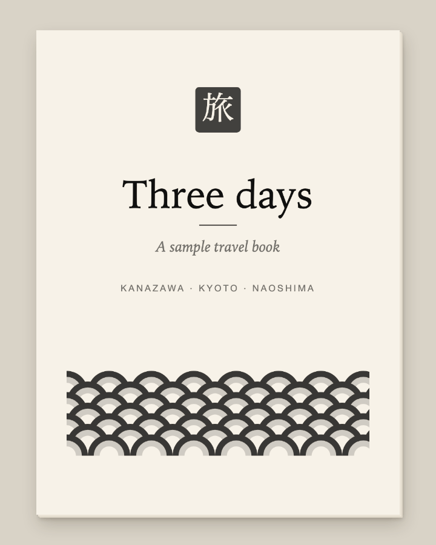

# A travel book you write with Claude, and read on a Kindle.

How I made one for a trip: the method, with an invented trip so you can see every part of it.

[](https://re4mat-mp.github.io/travel-book-method/)

**▶ [Open the book and turn the pages](https://re4mat-mp.github.io/travel-book-method/)**, with what's underneath each one · **⬇ [sample.epub](https://re4mat-mp.github.io/travel-book-method/sample.epub)**

A guidebook tells everyone the same thing. This is a book about *your* trip, one chapter per day, in the order
you'll live it, with the history of each place, the words you'll need that day, and drawings that explain what a
paragraph can't. Claude writes it with you; a repo keeps it; a short script turns it into an EPUB for a Kindle.

> **In three sentences.** The trip's private facts (dates, bookings, people) stay in a file that never enters the
> book or git; the book only takes the places and the order of the days. Every session that writes a chapter
> first reads a style file, because rules said only in a chat are gone the next day. The drawings are code, so one
> drawing comes out grey for e-ink and in colour for a tablet, and a change is a rebuild.

## Try it in 10 minutes

1. **Build the sample and read it.** You need `bash`, `zip` and `perl` (already there on a Mac and most Linux).

   ```bash
   git clone https://github.com/re4mat-mp/travel-book-method && cd travel-book-method
   bash scripts/build-epub.sh
   ```

   You get `sample.epub`: open it in Apple Books or any e-reader app, or send it to a Kindle with Amazon's Send to
   Kindle. `bash scripts/build-epub.sh color` makes the colour edition for a tablet.
2. **Write a day with Claude.** Open Claude Code in the repo and paste [`prompts/write-a-day.md`](prompts/write-a-day.md)
   with a place you know. [`CLAUDE.md`](CLAUDE.md) and [`STYLE.md`](STYLE.md) tell the session the rules; it
   writes the chapter, wires it into the book and rebuilds the EPUB.
3. **Change a drawing.** Open [`plates/noren.py`](plates/noren.py), change a colour under `svg.color` in
   [`plates/common.py`](plates/common.py) or a label, and run `bash plates/render.sh noren` (needs `python3`,
   `ffmpeg`, any Chrome or Chromium, and a Japanese font, such as Noto CJK on Linux). Look at both PNGs in
   `book/OEBPS/img/` and `img-color/`.

## The method, in one screen

1. **The skeleton stays out of the book.** Dates, bookings, transport and who travels go in a private
   `SKELETON.md` that `.gitignore` keeps out of git. Sessions read it to know which day is where; the book takes
   only the places and the order. → [`SKELETON.example.md`](SKELETON.example.md)
2. **A style file every session reads first.** The order inside a chapter, the tone, and the content rules.
   A rule said once in a chat goes into this file, or the next session won't know it. → [`STYLE.md`](STYLE.md)
3. **One chapter per day, always built the same way.** Five phrases for that day near the top; then the place
   and how people live with it, with one fact to tell at the table along the way; then what to look at and the
   sources. →
   [`book/OEBPS/day-2-kyoto.xhtml`](book/OEBPS/day-2-kyoto.xhtml)
4. **Every foreign word three ways:** script · romanisation · meaning (暖簾 · noren · the curtain over the door),
   so you can say it out loud and still recognise it on a sign.
5. **No times, prices or bookings, anywhere.** They change, and they live in your tickets and calendar. The book
   holds what doesn't change, which is also what makes it shareable.
6. **Every fact with its source.** At the end of each chapter, with tourism and commercial sources marked. Where
   sources disagree, the text says "several guides say…" instead of picking one.
7. **Drawings as code, in two editions.** A Python file writes an SVG. Grey by default; colours only under one
   CSS class, so the same file renders for e-ink or for a tablet. → [`plates/`](plates/)
8. **A companion for the road.** A Claude Project that has read the book answers on the street; edits happen in
   a Claude Code session on the repo, even from a tablet. → [`COMPANION.md`](COMPANION.md)

## Mistakes included

- **The cover said one more day than the trip had.** The count was fixed everywhere in the text, but the cover's
  subtitle is drawn into the cover image, so fixing the text never touched it. Here that's a rule in the style
  file: one number, one place, and when it changes, grep the text *and* the code that draws the images.
- **The book was organised by topic first.** Version two went one chapter per day, in the order you live them,
  so on the road you open the day you're in. The first version was kept whole as a backup before the restructure.
- **Send to Kindle rejected the book.** Colour PNGs had made it almost 3 MB. Saving the plates as 8-bit grey cut
  it to about 1.6 MB and the rejection went away; the colour plates moved to their own edition.
- **Letters had coloured fringes on e-ink.** Chrome's subpixel text rendering. `--disable-lcd-text` in the
  renderer fixed it. → [`plates/render.sh`](plates/render.sh)
- **A style file, so the next session can pick up the work.** Rules agreed in one conversation don't reach the
  next one. Writing them into `STYLE.md` and `CLAUDE.md` is what carries them across sessions.
- **Seven location maps were planned and cut before they were drawn.** A map of where things are competes with
  the phone in your pocket, and loses. The maps that stayed explain what a phone can't, like the shape of the
  whole trip.

<details>
<summary><b>What's in the repo</b></summary>

| Path | What it is |
|---|---|
| `book/` | The sample book as EPUB source: `OEBPS/` has one `.xhtml` per chapter, `style.css`, `content.opf` (manifest and reading order), `nav.xhtml` and `toc.ncx` (the two tables of contents e-readers use), and the plates in `img/` (grey) and `img-color/` (colour) |
| `plates/` | One Python file per drawing, `common.py` with the two-edition styles, `render.sh` to draw them with headless Chrome |
| `scripts/build-epub.sh` | Zips `book/` into an EPUB: `mimetype` first and uncompressed, the rest compressed. `color` for the colour edition |
| `scripts/build-pages.sh` | Copies the book into `docs/` for the web page and builds the two EPUBs there |
| `STYLE.md`, `CLAUDE.md` | The rules every session reads |
| `SKELETON.example.md` | The shape of the private trip file |
| `prompts/` | Two briefs to paste into a session: write a day, draw a plate |
| `COMPANION.md` | The Claude Project instructions template, and how editing works on the road |
| `docs/` | The page GitHub Pages serves: the book reader, with a text version that works with JavaScript off |
| `assets/book.gif` | The animation at the top of this README |
| `CUT.md` | What's in this repo, what stayed private, and how it was checked |

</details>

<details>
<summary><b>Why an EPUB and not a PDF</b></summary>

An EPUB reflows: the reader picks the font size, and the text fits a 6-inch e-ink screen, a phone or a tablet.
A PDF is a picture of a page. The cost is that e-readers ignore most CSS, so the style sheet is kept plain on
purpose: whatever a Kindle ignores should fail quietly.

</details>

## License

MIT. The sample book's text and drawings are part of it: reuse them, change them, make your own.
